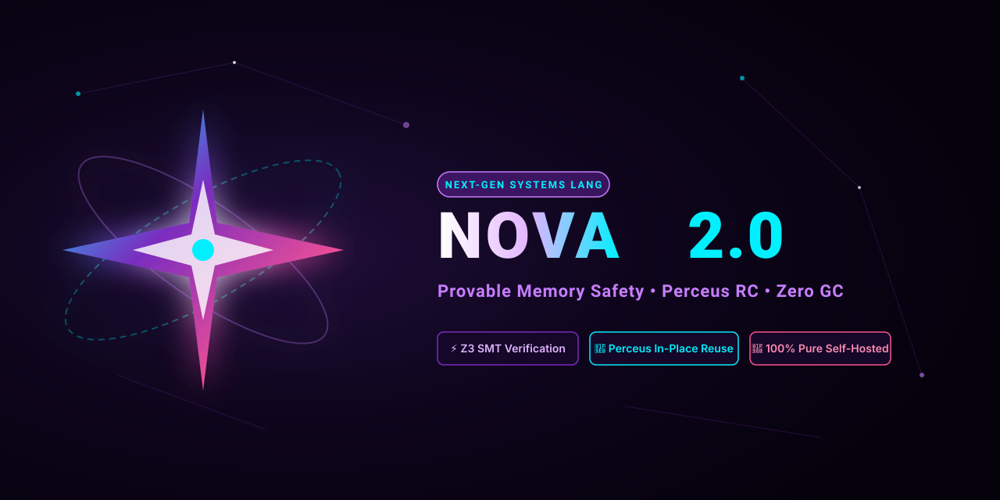

<p align="center">
  
</p>

<p align="center">
  <a href="https://github.com/novasystems-dev/nova/actions/workflows/release.yml"></a>
  <a href="https://github.com/novasystems-dev/nova/releases/latest"></a>
  <a href="LICENSE"></a>
  <a href="tests/"></a>
  <a href="https://github.com/novasystems-dev"></a>
</p>

<h3 align="center">
  <b>Provable Memory Safety • Perceus In-Place Reuse • Zero GC • SMT Refinements • Bare-Metal Systems Control</b>
</h3>

---

## 🌌 Overview

**Nova** is an advanced, industrial-grade systems programming language engineered to achieve the memory safety guarantees of Rust, the raw execution speed and bare-metal hardware control of C/C++, and the mathematical correctness proofs of SMT-backed Refinement Types (via Microsoft Z3).

The Nova project is governed by **Nova Systems** and developed under the [`@novasystems-dev`](https://github.com/novasystems-dev) GitHub organization following an ultra-clean, multi-repository architecture modeled after `rust-lang`.

---

## ⚡ Core Language Pillars

1. **Deterministic Zero-GC Memory Management**:
   Nova employs the **Perceus reference-counting model** with compile-time in-place buffer recycling. When an object's reference count is 1, mutations execute destructively in place without allocating new memory chunks, eliminating both garbage collection pauses and manual `malloc`/`free` errors.
2. **Compile-Time Formal Verification**:
   Critical program invariants (such as non-zero division, array index bounds, buffer capacities, and non-negative counts) are proven at compile time using the **Microsoft Z3 SMT solver**.
3. **100% Pure Self-Hosted Toolchain**:
   The Nova compiler (`novac`), package manager (`orbit`), and developer utilities are written in 100% Pure Nova, targeting both **Direct LLVM IR** and **C99/Clang** backends.
4. **Bare-Metal & Kernel Parity**:
   Hardware raw pointers (`*mut T`, `*const T`), address-of (`&val`), dereference (`*ptr`), inline assembly, and capability-gated concurrency (`iso`, `val`, `ref`).
5. **Industrial Standard Library**:
   33 high-performance standard modules including B-Trees, Bloom Filters, LRU Caches, Priority Queues, Linear Algebra Matrices, AES/SHA/ChaCha20 cryptography, Network Sockets, and Async Event Loops.

---

## 🚀 Quickstart & Installation

### Linux & macOS (Apple Silicon / Intel x86-64)
```bash
# One-line automated install
curl -fsSL https://raw.githubusercontent.com/novasystems-dev/nova/master/install.sh | bash

# Or from local clone / release archive:
./install.sh
export PATH="$HOME/.local/bin:$PATH"
```

### Windows (PowerShell / Command Prompt)
```powershell
# One-line automated install in PowerShell
irm https://raw.githubusercontent.com/novasystems-dev/nova/master/install.ps1 | iex

# Or run the Windows installer from extracted release:
.\install.ps1
# or: install.bat
```

> **Precompiled Native Binaries**: Standalone executable archives (`.zip` for Windows, `.tar.gz` for macOS & Linux) are available on [GitHub Releases](https://github.com/novasystems-dev/nova/releases/latest). Zero dependencies required to run precompiled binaries.

---

## 🛠️ Running Nova Code

```bash
# Compile and run an example
novac run examples/01_hello.nova

# Compile an enterprise B-Tree indexed database
novac run examples/10_btree_database.nova

# Compile a scientific linear algebra neural network
novac run examples/12_matrix_neural_network.nova

# Compile with Z3 formal refinement verification
novac check examples/02_refinements_z3.nova
```

---

## 📦 The Nova Multi-Repo Ecosystem

Nova is structured across 10 official repositories under [`@novasystems-dev`](https://github.com/novasystems-dev):

| Repository | Purpose | Primary Tech |
|---|---|---|
| [`novasystems-dev/nova`](https://github.com/novasystems-dev/nova) | Core Pure Nova Compiler, Standard Library & Runtime | Pure Nova, C99, LLVM |
| [`novasystems-dev/orbit`](https://github.com/novasystems-dev/orbit) | Official Package Manager & Build System (like Cargo) | Pure Nova |
| [`novasystems-dev/nova-analyzer`](https://github.com/novasystems-dev/nova-analyzer) | Official LSP Server, Tree-Sitter & VS Code Extension | TypeScript, Tree-sitter |
| [`novasystems-dev/nova-runtime`](https://github.com/novasystems-dev/nova-runtime) | Perceus Chunk Allocator & Bare-Metal Fiber Scheduler | C99, Pthreads |
| [`novasystems-dev/nova-tools`](https://github.com/novasystems-dev/nova-tools) | Developer Utilities (`nova-fmt`, `nova-lint`, `nova-doc`, `nova-repl`) | Nova, Python |
| [`novasystems-dev/rfcs`](https://github.com/novasystems-dev/rfcs) | Formal Language Evolution Process (RFCs 0001, 0002, 0003) | Markdown |
| [`novasystems-dev/book`](https://github.com/novasystems-dev/book) | Official Language Guide & Documentation (mdBook) | mdBook |
| [`novasystems-dev/awesome-nova`](https://github.com/novasystems-dev/awesome-nova) | Curated List of Libraries, Frameworks & Community Showcases | Markdown |
| [`novasystems-dev/playground`](https://github.com/novasystems-dev/playground) | Interactive In-Browser Monaco Code Sandbox | HTML, Monaco |
| [`novasystems-dev/nova-legacy-haskell`](https://github.com/novasystems-dev/nova-legacy-haskell) | Genesis Stage 0 Haskell Prototype Archive | Haskell, Cabal |

---

## ⚖️ License & Copyright

Nova is released under the **PolyForm Noncommercial License 1.0.0**.

- **Copyright Holder**: `Copyright (c) 2026 Fyew999 (Nova Systems)`.
- **Community Freedom**: You are free to view, fork, modify, recode, research, teach, and contribute to the Nova codebase for non-commercial purposes.
- **Commercial Protection**: Commercial exploitation, proprietary closed-source redistribution, or sale of the software is strictly prohibited. The author (`Fyew999`) retains full legal rights to enforce copyright under international law.
