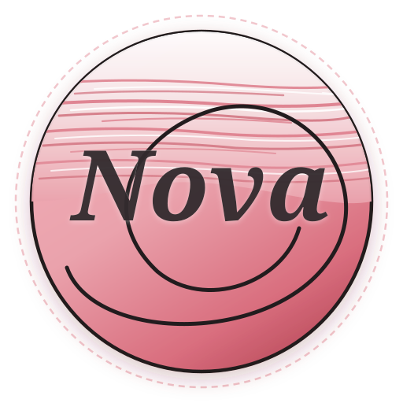

<div align="center">



# 🌌 Nova Systems Language

**Provable Memory Safety • Perceus In-Place Reuse • Zero GC • SMT Refinements • Bare-Metal Control**

<br />

[](https://novasystems-dev.github.io)
[](https://github.com/novasystems-dev/nova/actions)
[](https://github.com/novasystems-dev/nova/releases/latest)
[](tests/)
[](LICENSE)
[](compiler/)
[](https://github.com/novasystems-dev)

<br />

</div>

---

## ⚡ Overview

**Nova** is a modern systems programming language engineered to achieve the memory safety guarantees of Rust, the raw execution speed and bare-metal hardware control of C/C++, and the mathematical correctness proofs of SMT-backed Refinement Types (via Microsoft Z3).

The Nova project is governed by **Nova Systems** and developed under the [`@novasystems-dev`](https://github.com/novasystems-dev) GitHub organization following an ultra-clean, multi-repository architecture modeled after `rust-lang`.

---

## 🏛️ Key Language Pillars

1. **Deterministic Zero-GC Memory Management**:
   Nova employs the **Perceus reference-counting model** with compile-time in-place buffer recycling. When an object's reference count is 1, mutations execute destructively in place without allocating new memory chunks, eliminating both garbage collection pauses and manual `malloc`/`free` errors.
2. **Compile-Time Formal Verification**:
   Critical program invariants (such as non-zero division, array index bounds, buffer capacities, and non-negative counts) are proven at compile time using the **Microsoft Z3 SMT solver**.
3. **100% Pure Self-Hosted Toolchain**:
   The Nova compiler (`novac`), package manager (`orbit`), and developer utilities are written in 100% Pure Nova, targeting both **Direct LLVM IR** and **C99/Clang** backends.
4. **Bare-Metal & Kernel Parity**:
   Hardware raw pointers (`*mut T`, `*const T`), address-of (`&val`), dereference (`*ptr`), inline assembly, and capability-gated concurrency (`iso`, `val`, `ref`).
5. **Industrial Standard Library**:
   50 high-performance standard modules including B-Trees, Bloom Filters, LRU Caches, Priority Queues, Linear Algebra Matrices, Unicode 15.1 tables, AES/SHA/ChaCha20 cryptography, HTTP/2 framing, DNS wire protocol, 2D Physics, Geometry KD-Tree, WAV audio synthesizer, Network Sockets, and Async Event Loops.

---

## 🚀 Quickstart & Installation

### Linux & macOS (Apple Silicon / Intel x86-64)
```bash
# One-line automated install
curl -fsSL https://raw.githubusercontent.com/novasystems-dev/nova/master/install.sh | bash

# Or from local clone / release archive:
./install.sh
export PATH="$HOME/.local/bin:$PATH"
```

### Windows (PowerShell / Command Prompt)
```powershell
# One-line automated install in PowerShell
irm https://raw.githubusercontent.com/novasystems-dev/nova/master/install.ps1 | iex

# Or run the Windows installer from extracted release:
.\install.ps1
# or: install.bat
```

> **Precompiled Native Binaries**: Standalone executable archives (`.zip` for Windows, `.tar.gz` for macOS & Linux) are available on [GitHub Releases](https://github.com/novasystems-dev/nova/releases/latest). Zero dependencies required to run precompiled binaries.

---

## 🏛️ Pure Nova Colossus Bare-Metal Runtime & Industrial Ecosystem

Nova features an uncompromising **100% Pure Nova Native** foundation designed to eliminate C, libc, and external runtime dependencies entirely ("The Great C Purge"):

- **Direct Bare-Metal Kernel System Calls**: Zero-libc x86_64 Linux syscalls (`std/runtime/sys_linux.nv`) & Windows NT VirtualMemory/Thread subsystems (`std/runtime/sys_windows.nv`).
- **Direct Standalone Binary Codegen**: Direct ELF64 Linux executable builder (`compiler/backend/elf64.nv`) & Windows PE32+ `.exe` builder (`compiler/backend/pe.nv`) with native opcode encoding (`compiler/backend/x86_64_enc.nv`).
- **Perceus In-Place Slab Allocator**: Zero-fragmentation, deterministic reference-counted memory reuse (`std/runtime/perceus_alloc.nv`).
- **High-Throughput Web & Storage**: Event reactor HTTP/1.1 & HTTP/2 framework (`std/colossus_web.nv`) and Titan LSM-Tree with Raft consensus (`std/titan_db.nv`).
- **10 Industrial Standard Modules**:
  1. `std/ml_tensor.nv`: N-Dimensional tensors, matrix multiplication shapes & scaled activation functions.
  2. `std/crypto_postquantum.nv`: NIST-standardized Kyber/ML-KEM lattice cryptography & Poly1305 MAC authenticator.
  3. `std/distributed_cluster.nv`: Cluster node membership, Gossip protocol, & Phi Accrual failure detection.
  4. `std/tls13.nv`: TLS 1.3 cryptographic record layer & RFC 8446 handshake state machine.
  5. `std/grpc_pure.nv`: Pure Nova Protocol Buffers varint encoding & gRPC 5-byte framed streaming.
  6. `std/columnar_store.nv`: OLAP Parquet-style columnar chunk storage, RLE compression & ZoneMaps.
  7. `std/sql_query_engine.nv`: Relational algebra query plan optimizer, filter pushdown & cost estimation.
  8. `std/linear_algebra.nv`: Vector3D cross/dot products, Matrix 3x3 trace, determinant & invertibility proofs.
  9. `std/lockfree_queue.nv`: Atomic CAS sequences, MPMC ring buffers & hazard pointer memory reclamation.
  10. `std/bytecode_vm.nv`: Register-based bytecode virtual machine with instruction decoding & gas metering.

---

## ☕ Modular Enterprise Architecture & Java-Style Project Organization

Nova embraces a modular architecture inspired by Java/Spring Boot enterprise conventions, scaling from lightweight scripts to million-line enterprise ecosystems:

### File Extension Convention:
- **Source Code (`*.nv`)**: Developer source files are named with the sleek `.nv` extension (similar to `.rs`, `.go`, `.ts`, `.py`).
- **Native Executable Bundle (`*.nova`)**: Compiled standalone native binaries are bundled as `*.nova` (analogous to Java's `.jar`, but compiled to native C99/LLVM machine code with zero VM overhead).

### Architectural Layering (Separation of Concerns):
An enterprise Nova service organizes code across granular, decoupled layers:

```text
examples/enterprise_service/
├── Orbit.toml
└── src/
    ├── config/           # Server, Database, and Cryptographic Security settings
    │   ├── app_config.nv
    │   ├── database_config.nv
    │   └── security_config.nv
    ├── models/           # Domain entities with formal Z3 invariant contracts
    │   ├── user.nv
    │   ├── account.nv
    │   ├── transaction.nv
    │   ├── audit_log.nv
    │   └── session.nv
    ├── dto/              # API request payloads & standardized envelopes
    │   ├── api_response.nv
    │   ├── auth_dto.nv
    │   ├── account_dto.nv
    │   └── transfer_dto.nv
    ├── repository/       # Data persistence & atomic balance mutations
    │   ├── user_repo.nv
    │   ├── account_repo.nv
    │   ├── transaction_repo.nv
    │   └── audit_repo.nv
    ├── service/          # Business logic, token minting & ledger reconciliation
    │   ├── crypto_service.nv
    │   ├── auth_service.nv
    │   ├── account_service.nv
    │   ├── transfer_service.nv
    │   └── audit_service.nv
    ├── middleware/       # Observability, Rate Limiting, CORS & Auth Guards
    │   ├── logger_middleware.nv
    │   ├── auth_guard.nv
    │   ├── rate_limiter.nv
    │   └── cors_filter.nv
    ├── controllers/      # Health, Authentication, Account & Transfer Endpoints
    │   ├── health_controller.nv
    │   ├── auth_controller.nv
    │   ├── account_controller.nv
    │   └── transfer_controller.nv
    └── main.nv           # Application bootstrap & dependency injection runner
```

### Building & Running with Orbit:
```bash
# Create a new project (scaffolds src/main.nv)
orbit new cloud_ledger

# Compile multi-file project into standalone native bundle
cd cloud_ledger
orbit build   # Emits target/release/app.nova

# Execute native binary directly
orbit run     # Runs target/release/app.nova
```

---

## 🛠️ Running Nova Code

```bash
# Compile and run an example
novac run examples/01_hello.nv

# Compile an enterprise B-Tree indexed database
novac run examples/10_btree_database.nv

# Compile a scientific linear algebra neural network
novac run examples/12_matrix_neural_network.nv

# Compile with Z3 formal refinement verification
novac check examples/02_refinements_z3.nv
```

---

## 📦 The Nova Multi-Repo Ecosystem

Nova is structured across 10 official repositories under [`@novasystems-dev`](https://github.com/novasystems-dev):

| Repository | Purpose | Primary Tech |
|---|---|---|
| [`novasystems-dev/nova`](https://github.com/novasystems-dev/nova) | Core Pure Nova Compiler, Standard Library & Runtime | Pure Nova, C99, LLVM |
| [`novasystems-dev/orbit`](https://github.com/novasystems-dev/orbit) | Official Package Manager & Build System (like Cargo) | Pure Nova |
| [`novasystems-dev/nova-analyzer`](https://github.com/novasystems-dev/nova-analyzer) | Official LSP Server, Tree-Sitter & VS Code Extension | TypeScript, Tree-sitter |
| [`novasystems-dev/nova-runtime`](https://github.com/novasystems-dev/nova-runtime) | Perceus Chunk Allocator & Bare-Metal Fiber Scheduler | C99, Pthreads |
| [`novasystems-dev/nova-tools`](https://github.com/novasystems-dev/nova-tools) | Developer Utilities (`nova-fmt`, `nova-lint`, `nova-doc`, `nova-repl`) | Nova, Python |
| [`novasystems-dev/rfcs`](https://github.com/novasystems-dev/rfcs) | Formal Language Evolution Process (RFCs 0001, 0002, 0003) | Markdown |
| [`novasystems-dev/book`](https://github.com/novasystems-dev/book) | Official Language Guide & Documentation (mdBook) | mdBook |
| [`novasystems-dev/awesome-nova`](https://github.com/novasystems-dev/awesome-nova) | Curated List of Libraries, Frameworks & Community Showcases | Markdown |
| [`novasystems-dev/playground`](https://github.com/novasystems-dev/playground) | Interactive In-Browser Monaco Code Sandbox | HTML, Monaco |
| [`novasystems-dev/nova-legacy-haskell`](https://github.com/novasystems-dev/nova-legacy-haskell) | Genesis Stage 0 Haskell Prototype Archive | Haskell, Cabal |

---

## ⚖️ License & Copyright

Nova is released under the **PolyForm Noncommercial License 1.0.0**.

- **Copyright Holder**: `Copyright (c) 2026 Fyew999 (Nova Systems)`.
- **Community Freedom**: You are free to view, fork, modify, recode, research, teach, and contribute to the Nova codebase for non-commercial purposes.
- **Commercial Protection**: Commercial exploitation, proprietary closed-source redistribution, or sale of the software is strictly prohibited. The author (`Fyew999`) retains full legal rights to enforce copyright under international law.
